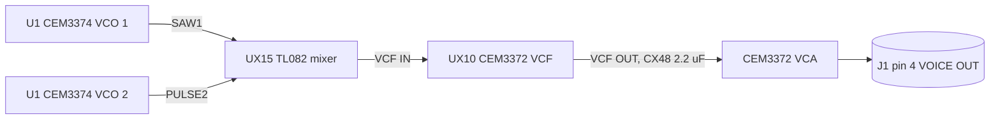

# Read a circuit diagram into a report (one job: every part, net and law on one image, written down)

Mermaid is the map and a SPICE netlist is the model. An image of a schematic is the most exact source a rebuild has, and the easiest to half-read: a value too small to see at full view, a hand note, a capacitor nobody modelled. Each image gets its own report, so several agents can work at once, and a README ties them together.

<constraints>
Always do:
1. One image, one report: `<out>/<NN>-<what it shows>.md`, numbered in the images' order. Never two images in one report, and never two agents on one image.
2. Read at full resolution. Cut the image into overlapping tiles (about 1,100 px, 100 px overlap), read every tile, then the whole image for layout. Zoom twice into any tile where a value or a pin number is not plain. Write each tile's name beside what was read from it.
3. Write the report with these sections, in order:
   - **Source:** the file, the sheet's number and title block, revision, and board.
   - **What it does:** one paragraph.
   - **Diagram:** a Mermaid `flowchart` of the signal: each chip and stage a node named by its reference (`UX15 TL082 pole mixer`), each net an edge with its name or value, the inputs and outputs, and each connector with its pins. Keep it readable: one chart per stage when the sheet is dense.
   - **Parts:** a table of every resistor, capacitor, diode, transistor, chip, trimmer, switch and connector: reference, type, value and tolerance as printed, and what it connects to. Give the count.
   - **Chips:** a table of each chip: reference, part number, function here, and a link to `chips/<part>.md`.
   - **Nets:** each named net, where it goes, and every line that leaves the sheet, with the sheet it goes to.
   - **Laws:** what the parts compute, each as formula, values and result: gains, dividers, corner frequencies (1/(2 pi R C)), time constants, current sources, scales such as volts per octave, offsets and limits.
   - **Notes on the drawing:** hand notes, brackets, revision marks, "not used", jumpers and options.
   - **Not read:** what could not be read, the tile, and why.
   - **For the build:** what code that rebuilds this must hold, as a list of facts with their reference.
4. Write a SPICE netlist for every analog stage, which is the exact model the Mermaid chart is not: `netlists/<NN>-<stage>.cir`, one stage a file. Every part with its reference, value and the two nodes it joins, nodes named by the sheet's nets and pins, a chip as a behavioural subcircuit from its datasheet and marked so, and a `.control` block that sweeps or steps what matters: a filter's response, a corner, a level, a gain. Digital logic needs none. Simulate with `ngspice -b`, and set the result against the code's own response at the same settings. A difference is a misread or a fault in the code, and either is worth finding.
5. Write `chips/<part>.md` once per part number, by one agent per chip. Find the datasheet from the maker first, then archives such as alldatasheet or datasheetarchive. Save it outside the repo, and read it with `pdf-to-md`, images included. Record its function, pinout, every figure in its tables with units and conditions, its equations, the curves read as numbers, its typical application, and what a model must hold that an ideal part would not: offsets, drift, temperature, distortion, noise, limits, leakage. Say which figures are typical and which are guaranteed.
   When the data sheet lacks a curve a model needs, such as a taper, a law between two end points, or behaviour with temperature or level, look further before calling it a gap: a reissue or a pin-compatible copy (a modern clone's data sheet often has the graphs the original lacked), the maker's application notes, other instruments' service manuals that use the chip, and measurements others have published. Save what you find beside the data sheet, say which part each curve is from, and tag a copy's curve as a lead for the original, never as the original's. If nothing has it, the law stays a `[gap]`, with the list of what was searched.
6. Write `README.md`: a table of every report (image, sheet, title, one line), the chips with links, a Mermaid map of how the sheets join through their connectors, the netlists and what each simulates, and everything not read.
7. Check the work. Every part on the image is in its table, so count them. Every connector pin is found on its other sheet. Every value in Laws and in a netlist is one the image shows.
8. Last, set the reports against the code that rebuilds the circuit. Make a table of each law and value: where the code holds it, and whether it matches, differs or is missing. That table is the point of the whole exercise.

Never do:
- Guess a value, or fill one in from a "typical" circuit. Write `[?]` with the tile instead.
- Read a sheet from its OCR text, or at screen size only.
- Leave out a hand note, a part marked "not used" or an option: they explain units that differ.
- Copy a datasheet, a manual page or an image into the repo. Link the source, and keep the file outside.
- Call a sheet read while its "Not read" list has rows nobody followed up.
</constraints>

A diagram, in the form the reports use:

